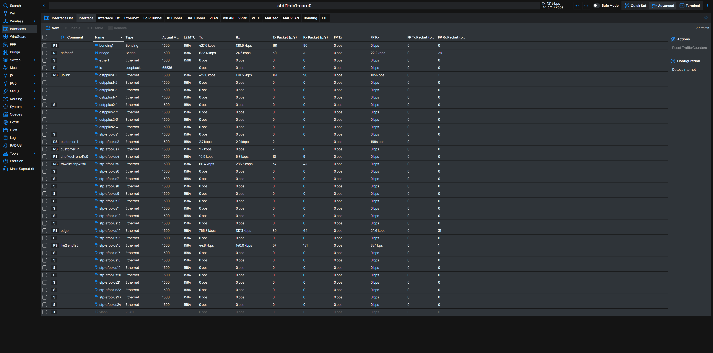

[](https://github.com/tall1on/routeros-darkmode-extension/releases/tag/v7.25.2)

[](https://chromewebstore.google.com/detail/routeros-dark-mode/oialmnigabiamlbdlmhgnnoaigcpngoi)

# Mikrotik RouterOS Dark Mode Extension



Chrome extension that applies a dark theme to the MikroTik RouterOS (WebFig) web interface.

## Prerequisites

- Node.js 20.19+ or 22.12+
- npm (bundled with Node.js)

## Installation

```bash
npm install
```

## Available Scripts

- `npm run clean` – Remove build artifacts (`dist/`).
- `npm run typecheck` – Type-check sources with the tsgo-backed `typescript-native-bridge`.
- `npm run build` – Type-check, then produce production bundles for content script, background worker, styles, and copy static assets to `dist/`.
- `npm run watch` – Watch source files and rebuild on change.

All build artifacts are emitted to the `dist/` directory.

## License

See [`LICENSE`](LICENSE) for details.
